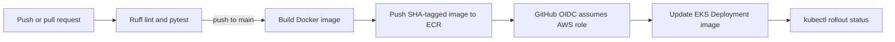

# End-to-end CI/CD on GitHub Actions, ECR, and EKS

A small FastAPI service and a deployment pipeline that runs checks on every pull request, publishes an immutable image to Amazon ECR after a push to `main`, and rolls it out to an existing Amazon EKS cluster.

## Pipeline



Pull requests run lint and unit tests. Pushes to `main` run those same checks, then build and push an image tagged with the commit SHA and update the EKS Deployment. Kubernetes uses a rolling update with readiness and liveness probes; the workflow waits for rollout completion and fails if it times out.

## Run locally

Requires Python 3.12+ and Docker (for the container path).

```bash
python -m venv .venv
# Windows PowerShell: .venv\Scripts\Activate.ps1
# macOS/Linux: source .venv/bin/activate
python -m pip install -r requirements-dev.txt
ruff check .
pytest
uvicorn app.main:app --reload
```

Open <http://localhost:8000/>. Health endpoints are `/health/live` and `/health/ready`.

Build and run the container:

```bash
docker build -t ci-cd-demo:local .
docker run --rm -p 8000:8000 ci-cd-demo:local
```

## AWS and GitHub setup

This repository deploys to existing AWS infrastructure. Applying the included `LoadBalancer` Service will provision a public AWS load balancer and incur charges; delete the Service or change it to `ClusterIP` when you no longer need external access. Prepare:

1. An ECR repository for the image.
2. An EKS cluster with a reachable Kubernetes API, a node group, and `kubectl` access for the GitHub Actions role.
3. An IAM OIDC provider for `token.actions.githubusercontent.com` in the AWS account.
4. An IAM role trusted by that OIDC provider. Restrict its trust policy to this repository and the `main` branch (example below).
5. Grant the role ECR push permissions for the one repository and `eks:DescribeCluster` for the cluster. Also authorize the role in the cluster's EKS access configuration with permission to update and watch the `Deployment` in namespace `demo` (or map it through the cluster's access mechanism).

Set these repository **variables** under **Settings → Secrets and variables → Actions → Variables**:

| Variable | Example |
| --- | --- |
| `AWS_REGION` | `us-east-1` |
| `AWS_ROLE_ARN` | `arn:aws:iam::123456789012:role/github-actions-ci-cd` |
| `ECR_REPOSITORY` | `end-to-end-ci` |
| `EKS_CLUSTER_NAME` | `demo-eks` |

No long-lived AWS access key is needed. The workflow receives a short-lived token through GitHub OIDC. The AWS role needs ECR authorization-token access plus upload actions scoped to the ECR repository, and `eks:DescribeCluster`. Kubernetes authorization is separate from IAM: authorize the role in EKS for the `demo` namespace.

### Example OIDC trust policy

Replace the account ID, organization, and repository values. The subject condition limits role assumption to pushes on `main` in the named repository.

```json
{
  "Version": "2012-10-17",
  "Statement": [{
    "Effect": "Allow",
    "Principal": { "Federated": "arn:aws:iam::123456789012:oidc-provider/token.actions.githubusercontent.com" },
    "Action": "sts:AssumeRoleWithWebIdentity",
    "Condition": {
      "StringEquals": { "token.actions.githubusercontent.com:aud": "sts.amazonaws.com" },
      "StringLike": { "token.actions.githubusercontent.com:sub": "repo:YOUR_ORG/YOUR_REPO:ref:refs/heads/main" }
    }
  }]
}
```

The workflow expects the ECR repository and EKS cluster to exist. On the first deployment, Kubernetes creates the namespace and Deployment from `k8s/`; subsequent deployments update the image of the existing Deployment. The cluster nodes need network access to pull from ECR.

## Project layout

- `app/` — service and health endpoints
- `tests/` — endpoint tests
- `Dockerfile` — non-root, small Python image
- `.github/workflows/ci-cd.yml` — checks, ECR publish, EKS rollout
- `k8s/` — namespace, Deployment, and Service

## Resume line

After deploying and recording a successful rollout in your own AWS account, replace the placeholders with measured results, for example: “Built a GitHub Actions CI/CD pipeline with Docker, Amazon ECR, and Amazon EKS; automated linting, tests, image publishing, and rolling deployments.” Only add “zero downtime,” cluster size, or a deployment duration after you have verified those conditions in your environment.
